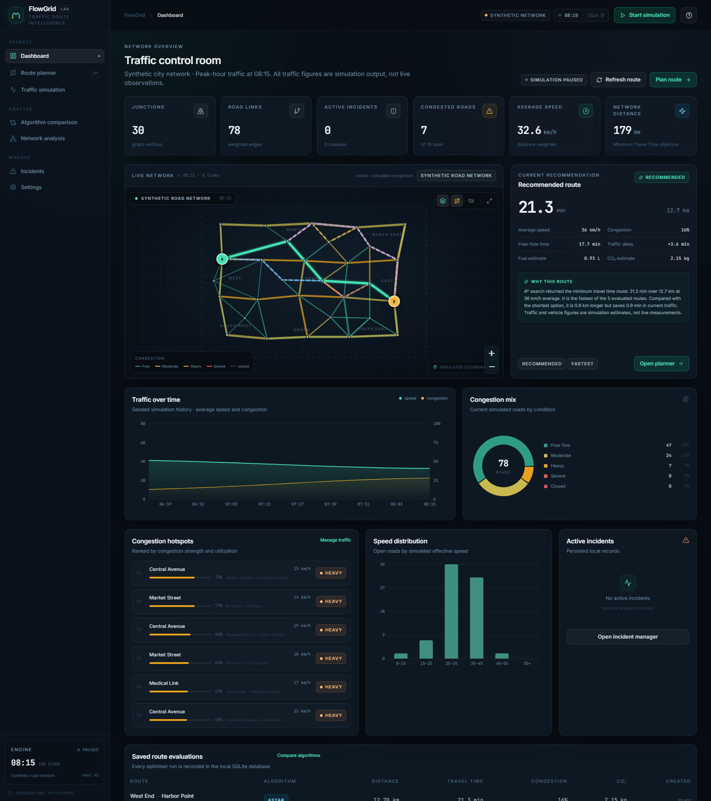

# FlowGrid

**Traffic route intelligence with graph theory, simulated congestion and inspectable route decisions.**

FlowGrid is a working engineering demo, not a static dashboard. It builds a directed weighted road graph, computes routes with Dijkstra, A*, Yen's K-shortest paths and an experimental ant-colony optimiser, and recalculates edge costs from a seeded traffic simulation. The map displays the actual routes returned by the engine.



---

## Quick start

### Windows (no build step)

Requires **Python 3.10+**. The bundled `frontend/dist` is already built; no backend packages are needed for the standard runtime.

```bat
run.cmd
```

or:

```powershell
powershell -NoProfile -ExecutionPolicy Bypass -File .\run.ps1
```

Open **http://127.0.0.1:8787**.

### macOS / Linux

```bash
python3 backend/run.py
```

### Optional FastAPI runtime

The default launcher uses a dependency-free HTTP adapter with the same REST surface. To run the FastAPI adapter:

```bash
python -m pip install -r backend/requirements.txt
uvicorn app.api:app --app-dir backend --host 127.0.0.1 --port 8787
```

`requirements.txt` also lists NetworkX, NumPy and Pandas for the optional analysis/import layer. The core algorithms do not require them.

### Rebuild the frontend

Node.js 20.19+ or 22.12+ and pnpm are required:

```bash
cd frontend
pnpm install
pnpm build
```

`vite` proxies `/api` to `127.0.0.1:8787` during development (`pnpm dev`).

---

## What you can do

### Route planner
- Choose origin and destination from searchable junction pickers, or click the map.
- Select **Dijkstra**, **A***, **Yen K-shortest** or **ant colony**.
- Choose **fastest**, **shortest**, **low congestion**, **eco-friendly** or **balanced** routing.
- Adjust the four balanced-objective weights.
- Change the simulated demand profile and vehicle assumptions.
- Inspect the recommended route, alternatives, a full comparison table, segment-by-segment details, fuel/CO₂ estimates and a factual explanation.
- Switch between alternatives and preview each one on the map.

### Traffic simulation
- Eight reproducible scenarios: normal, peak hour, highway congestion, accident, road closure, emergency, eco and network-wide congestion.
- Start, pause, advance, reset, increase or decrease demand.
- Adjust the simulation step and random-event setting.
- Inject accidents, closures, construction, heavy congestion, special events and emergency obstructions.
- Recalculate routes immediately after graph changes.
- Watch congestion hotspots, speed distribution and the seeded trend chart.

### Analytics and comparison
- Dashboard with junctions, road links, active incidents, congested roads, average speed, network distance and stored route history.
- Congestion mix, speed distribution, traffic trend, hotspots and utilization by road class.
- Real benchmark of Dijkstra vs A* vs Yen vs ant colony on the same graph: execution time, explored nodes, peak memory, distance, travel time and objective cost.
- Topology analysis: connected components, degree distribution, reachable pairs, average shortest trip and current-path critical corridors.

### Incident management
- Active incidents and full persisted incident history.
- Closure and reopening of roads.
- Incident records include type, road, severity, start time, duration, source and operator note.
- SQLite persistence for incidents, route evaluations and simulation runs.

---

## Graph model

The network is a synthetic, clearly-labelled city called the FlowGrid demonstration network. It contains **30 junctions**, **78 road segments**, **151 directed edges**, ring roads, arterials, collectors, residential streets, five one-way segments and several alternate corridors. It works offline.

Each road carries:

| Attribute | Meaning |
|---|---|
| `distance_km` | Physical segment length |
| `speed_limit` | Free-flow speed |
| `effective_speed_kph` | Simulated speed after traffic and incidents |
| `travel_time_min` | `distance / effective_speed × 60` |
| `capacity` | Road capacity in vehicles/hour |
| `traffic_density_vph` | Simulated volume |
| `utilization` | Volume ÷ capacity |
| `congestion` | 0–100 simulated congestion score |
| `road_class` | Highway, arterial, collector or residential |
| `status` | Open or closed |
| `one_way` | Two-way, forward or reverse |

Two-way roads are expanded into two directed edges. One-way roads produce only the permitted direction. A closure removes the edge from the routing graph entirely.

### Traffic model

Every tick computes a demand/capacity ratio for each road:

```text
ratio = base_demand × hour_factor × demand_multiplier × capacity_factor + ripple
speed_factor = 1 / (1 + 2.15 × max(0, ratio - 0.16)^2.25)
effective_speed = speed_limit × speed_factor × incident_speed_factor
travel_time = distance / effective_speed × 60
```

`speed_factor` is bounded between 0 and 1. Incidents multiply speed and capacity; a closure sets the edge unavailable. Morning and evening peaks are smooth functions of the simulated clock. Random events use the reported seed, and each scenario returns the seed used.

> All traffic values are **simulation output**, not live or observed traffic. The UI labels this distinction repeatedly.

---

## Algorithms

### Dijkstra
Binary min-heap implementation over the weighted directed graph. Supports any additive objective and returns path, total cost, explored-node count and execution time. Non-negative weights are guaranteed.

### A*
Same graph and objective, with an admissible heuristic:
- **Distance objective:** straight-line distance is a lower bound on road distance.
- **Time objective:** straight-line distance ÷ network maximum speed × 60 is a lower bound on travel time.
- **Congestion / eco / balanced:** heuristic is zero, so A* behaves like Dijkstra unless a valid lower bound exists. This is deliberate; a distance heuristic is not used for time costs without conversion.

### Yen's K-shortest loopless paths
Yen's spur-node algorithm generates candidate alternatives, rejects duplicates and loops, and supports at least three routes when the graph has enough distinct alternatives. Edge-penalised Dijkstra diversification is used only when Yen candidates are scarce.

### Ant colony optimisation
Optional experimental search with 24 ants × 40 iterations by default, pheromone evaporation and reinforcement. It is never the only routing method and is benchmarked with the same edge costs.

### Objective costs
| Objective | Additive edge cost |
|---|---|
| Fastest | travel time |
| Shortest | distance |
| Least congestion | travel time × (0.30 + 1.70 × congestion/100) |
| Eco | estimated CO₂ × 10 + distance × 0.005 |
| Balanced | normalized time, distance, congestion and CO₂ with user weights |

The balanced objective normalises per-edge metrics before applying the configured weights, so the result is not dominated by the largest unit.

### Explanation generation
The recommendation explanation is built from actual route numbers: if the recommended route is not the shortest, it states the extra distance and the time difference; if it is slower than the fastest candidate, it states the gap and the congestion comparison. No claim is generated that is not supported by the calculated metrics.

---

## Fuel and emissions

The environmental model is configurable in **Settings**:

```text
efficiency_penalty = 1 + 0.30 × ((speed - 45) / 38)²
fuel_l = distance_km / 100 × L_per_100km × penalty
CO₂ = fuel_l × CO₂_kg_per_l
fuel_cost = fuel_l × fuel_price
```

Electric vehicles use kWh/100 km, electricity price and a grid CO₂ factor instead. The speed penalty makes stop-start traffic more expensive than a distance-only estimate. These are clearly documented engineering approximations, not OEM measurements.

---

## REST API

| Method | Endpoint | Purpose |
|---|---|---|
| GET | `/api/health` | Service, database and provider status |
| GET | `/api/network` | Junctions, roads, current simulated traffic |
| GET | `/api/network/analysis` | Topology and critical corridors |
| POST | `/api/network/import` | Optional OSMnx conversion boundary |
| GET | `/api/network/import/status` | OSMnx availability |
| POST | `/api/routes/optimize` | Recommended route + alternatives |
| POST | `/api/routes/alternatives` | Alternative-focused response |
| GET | `/api/traffic/status` | Simulation state, hotspots, trend |
| GET | `/api/traffic/providers` | Provider interface status |
| POST | `/api/traffic/simulate` | start / pause / reset / tick / level / step |
| POST | `/api/traffic/tick` | Advance simulation |
| POST | `/api/traffic/incidents` | Create incident |
| DELETE | `/api/traffic/incidents/{id}` | Resolve incident |
| POST | `/api/traffic/close-road` | Close a road |
| POST | `/api/traffic/open-road` | Reopen a road |
| GET | `/api/incidents` | Active incidents, history and types |
| GET | `/api/analytics` | Dashboard analytics |
| POST | `/api/benchmark` | Compare all four algorithms |
| GET | `/api/scenarios` | Scenario catalog |
| POST | `/api/scenarios/run` | Run a seeded scenario |
| GET | `/api/settings` | Read settings |
| PUT | `/api/settings` | Persist settings |
| GET | `/api/history/routes` | Stored route evaluations |

Example request:

```json
{
  "origin": "N06",
  "destination": "N15",
  "algorithm": "astar",
  "objective": "time",
  "weights": { "time": 0.4, "distance": 0.2, "congestion": 0.2, "eco": 0.2 }
}
```

Errors use structured JSON:

```json
{ "error": { "code": "route_not_found", "message": "No traversable route exists ...", "details": {} } }
```

---

## Database

SQLite (`data/flowgrid.db`) with a portable schema:

- `nodes` — node ID, name, latitude, longitude, local x/y, type, district.
- `roads` — road ID, endpoints, distance, speed limit, class, direction, capacity, lanes, status.
- `incidents` — incident ID, road, type, severity, timestamps, duration, status, source, note.
- `route_history` — route code, source, destination, algorithm, objective, metrics, created time.
- `simulation_runs` — scenario, seed, parameters JSON, results JSON, created time.
- `settings` — JSON values for defaults and vehicle configuration.

Foreign keys and indexes are created on startup. The schema avoids SQLite-specific routing features and maps directly to PostgreSQL tables; the DAL is isolated in `backend/app/db.py`.

---

## Project structure

```text
flowgrid/
├── backend/
│   ├── app/
│   │   ├── algorithms.py      # Dijkstra, A*, Yen, ACO, route metrics
│   │   ├── analytics.py       # distributions and topology analysis
│   │   ├── api.py             # optional FastAPI adapter
│   │   ├── db.py              # SQLite schema and persistence
│   │   ├── fuel.py            # configurable vehicle/environment model
│   │   ├── network_data.py    # deterministic synthetic city
│   │   ├── osm_adapter.py     # optional OSMnx boundary
│   │   ├── providers.py       # live-traffic provider interface
│   │   ├── scenarios.py       # eight seeded scenarios
│   │   ├── server.py          # dependency-free HTTP + static server
│   │   ├── service.py         # shared application service layer
│   │   └── traffic.py         # traffic simulation engine
│   ├── requirements.txt
│   └── requirements-osm.txt
├── frontend/
│   ├── src/
│   │   ├── components/        # map, charts, route cards, UI primitives
│   │   ├── pages/             # seven application views
│   │   ├── lib/               # API client and formatters
│   │   ├── state.tsx          # application state
│   │   ├── App.tsx
│   │   └── types.ts
│   ├── dist/                  # prebuilt production bundle
│   └── package.json
├── data/                      # local SQLite database
├── docs/ARCHITECTURE.md
├── shots/                     # verification screenshots
├── tests/test_core.py
├── run.cmd / run.ps1 / run.sh
└── README.md
```

---

## Tests

```powershell
$env:PYTHONPATH = "backend"
python -m unittest discover -s tests -v
```

The suite covers network validity, all-pairs reachability, A* vs Dijkstra optimality, Yen looplessness and uniqueness, ant-colony routing, objective influence, seeded reproducibility, incident speed effects, closure/reopening rerouting, settings persistence, scenario execution and benchmark measurement.

Current suite: **13 tests**.

---

## OSM and live traffic boundaries

- **Mode A, synthetic network:** fully functional, offline, default. This is the demonstration network used in all screenshots.
- **Mode B, OpenStreetMap:** an optional OSMnx adapter (`backend/app/osm_adapter.py`) converts a bounded OSM query into FlowGrid's portable node/road schema. It is intentionally not enabled when OSMnx is absent; the UI says so rather than showing fake OSM data. OSM imports are geometry only — traffic is never inferred from OSM and never labelled live.
- **Live traffic provider:** `backend/app/providers.py` defines the `TrafficProvider` interface (speed, congestion, incidents, timestamps, source, confidence). The simulation provider is active; a paid or open-data provider can be registered without changing the routing engine. No paid API is required.

---

## Known scope limits

- The display network is synthetic and its live-traffic appearance is **simulated**, not observed.
- The OSM adapter is optional and not installed in the default environment.
- The OSM preview endpoint returns converted data for review; it does not silently swap the active graph.
- Fuel and CO₂ figures are configurable estimates.
- Single-process SQLite and in-memory simulation state are appropriate for a demonstration, not a multi-tenant production deployment.

See [docs/ARCHITECTURE.md](docs/ARCHITECTURE.md) for the request flow, algorithm contracts, data model and production path.

## License

FlowGrid is available under the [MIT License](LICENSE).

